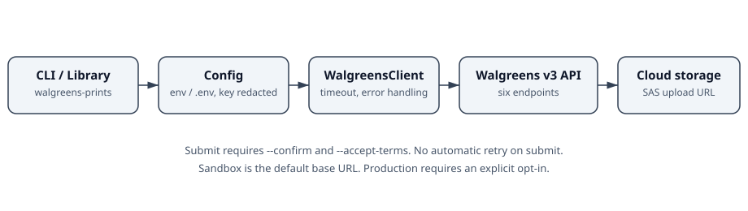
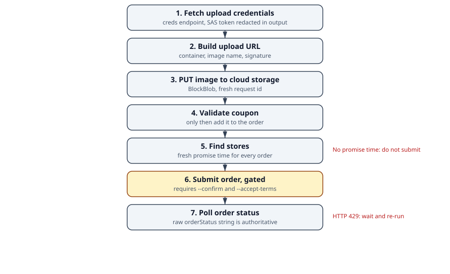

# walgreens-photo-prints

## Description

A Python client and CLI for the Walgreens Native Photo Prints API v3:
fetch upload credentials, list products and prices, validate coupons,
find photo stores, submit orders, and check order status. Uploads go to
Walgreens cloud storage via a short-lived SAS token, for same-day
pickup at a Walgreens store.

This is a standalone modernization of a small March 2024 client
(`ss-walgreens`) that covered only three of the six endpoints and made
network calls on import. It is not affiliated with or endorsed by
Walgreens.



Status: code complete, tests mocked only. No live Walgreens run has
been performed with this package, CI has not run until the first
push, and no release tag exists yet. See Deployment.

## Prerequisites

- Python 3.10 or later.
- Git, for cloning.
- A Walgreens Developer Portal account, plus your own API key and
  affiliate ID, for any live call. Mocked tests need no credentials.
- For a real order: a store, a promise time from `find_stores`, and a
  customer terms action (see Usage). Orders are real once submitted.

## Installation

This package is not published to PyPI. Install from a checkout:

```powershell
git clone https://github.com/enonymous1/walgreens-photo-prints.git
cd walgreens-photo-prints
pip install .
```

For development (editable install with test and lint tools):

```powershell
pip install -e ".[dev]"
```

Then copy the example environment file and fill in your own values:

```powershell
copy .env.example .env
```

```env
WALGREENS_API_KEY=your-api-key
WALGREENS_AFF_ID=your-affiliate-id
WALGREENS_BASE_URL=https://services-qa.walgreens.com
WALGREENS_APP_VER=1.0
WALGREENS_DEV_INF=YourDevice,1.0
```

Never commit `.env`, and never hardcode a key in source. If you are
migrating from the 2024 original, treat any key that was ever
committed as compromised: rotate or revoke it in the developer portal
and use a fresh key here. Defaults are the sandbox base URL, platform
`ios`, and a 30-second timeout; set `WALGREENS_BASE_URL` to
`https://services.walgreens.com` for production. `WALGREENS_APP_VER`
and `WALGREENS_DEV_INF` are optional for credentials and products and
required by the API for coupon, store, and submit calls.

## Local Development

On Windows (PowerShell):

```powershell
python -m venv .venv
.\.venv\Scripts\Activate.ps1
pip install -e ".[dev]"
pytest
ruff check src tests
ruff format --check src tests
```

On macOS/Linux, activate with `source .venv/bin/activate` instead.
Run a single test file with `pytest tests/test_client.py -q`. All
tests use mocked responses modelled on the API reference examples; no
test touches the live API, so the suite is safe to run anywhere.

Verify a change the way it will be consumed: install from a fresh
extraction into a fresh virtual environment, then run
`walgreens-prints --version`, `walgreens-prints --help`, and the full
suite from that copy. The CLI entry points are `walgreens-prints` and
`python -m walgreens_photo_prints`.

Configuration precedence, highest first: CLI flags, environment
variables, then the `.env` file (which never overwrites the
environment). Importing the package makes no network calls.

## Web front-end

Flask is an optional extra; the core library does not require it:

```powershell
pip install -e ".[web]"
walgreens-prints serve --demo
```

`serve` binds to `127.0.0.1:5000` by default (`--host`/`--port`
override it). Demo mode uses fictional data only and makes no
network call. Live mode (`walgreens-prints serve`, no `--demo`)
builds a real client from the environment, with credentials
server-side only: pages for products, stores, coupon, upload,
two-step submit (redacted preview, then confirm + terms action),
and status. Live mode has no login, so run it locally only; do
not expose it publicly.

## Pages freeze (demo only)

`scripts/freeze.py` renders the demo app with the Flask test
client into `freeze-site/` (gitignored, never committed), with
forms disabled and a static-demo banner. The Pages workflow
(`.github/workflows/pages-freeze.yml`) builds and deploys that
output on push to `main`, after the one-time Settings → Pages →
Source: GitHub Actions activation. The frozen site is a demo
only: it cannot take arbitrary input, upload a file, or place
an order. The freeze script builds its own demo app and takes
no credentials argument, so real data cannot be frozen by
accident. There is no live Pages app, because Pages is static
and cannot hold the API key.

## Usage

```powershell
walgreens-prints creds
walgreens-prints products --product-group-id STDPR
walgreens-prints coupon --code TESTFORALL --product-details cart.json
walgreens-prints stores --latitude 41.880977 --longitude -87.626481 --product-details cart.json
walgreens-prints status 0000000001 0000000002
walgreens-prints upload-url
walgreens-prints upload photo.jpg
```

`cart.json` for coupon and stores:

```json
[{"productId": "0000001", "qty": "10"}]
```

`submit` places a real order. Without `--confirm` it only prints the
redacted payload and exits with status 2. With `--confirm` you must
also pass `--accept-terms`, asserting the customer took the required
action on the terms element for this order:

```powershell
walgreens-prints submit --first-name "Jane" --last-name "Doe" --phone "5555555555" --email "jane@example.com" --store-num "211" --promise-time "03-02-2020 5:15 PM" --product-details order.json --confirm --accept-terms
```

`order.json` for submit:

```json
[{"productId": "8420005", "imageDetails": [{"url": "UPLOAD_URL", "qty": "1"}]}]
```

Library use:

```python
from walgreens_photo_prints import Config, WalgreensClient, upload_image_for_credentials

config = Config.from_env()
with WalgreensClient(config) as client:
    products = client.list_products()
    stores = client.find_stores("41.880977", "-87.626481", [{"productId": "1", "qty": "1"}])
    upload_url, status = upload_image_for_credentials(client, "photo.jpg")
```

`upload_image_for_credentials` fetches credentials exactly once per
upload. `creds` output redacts the SAS token; `upload-url` and `upload`
print a signed upload URL, so do not share that output.



### Endpoints

| Method | Endpoint | Rate limit |
|---|---|---|
| `fetch_upload_credentials` | `POST /api/photo/creds/v3` | 300/min |
| `list_products` | `POST /api/photo/products/v3` | 300/min |
| `validate_coupon` | `POST /api/photo/order/coupon/v3` | 100/min |
| `find_stores` | `POST /api/photo/store/v3` | 300/min |
| `submit_order` | `POST /api/photo/order/submit/v3` | 300/min |
| `get_order_status` | `POST /api/photo/order/status/v3` | 300/min |

Call `list_products` every time products or prices are shown; the API
states prices and products can change at any time. Validate a coupon
before adding it to a submit request. Fetch a fresh promise time from
`find_stores` for every order, and never submit to a store reporting
the no-promise-time sentinel (`01-01-3000 00:00 AM`, exposed as
`PhotoStore.is_no_promise_time`). Client-side order limits: at most
200 distinct images, at most 20 prints per image URL. The post-coupon
price limit (under $998) cannot be checked by this client; validate
the coupon and check the total before submitting. The client does not
retry or pace requests, and a 429 raises `WalgreensApiError` with
`throttled=True`; wait and re-run, and do not treat a throttled result
as a measurement. There is deliberately no automatic retry on submit:
it is not idempotent, so retrying after a timeout could place the
order twice.

### Known limitations and documentation notes

Responses are JSON objects with `err`/`errCode` and `errDesc` fields;
any non-empty error, or a `status` of `error`/`failure`, raises
`WalgreensApiError`. Lists are returned in the order the API returned
them and are never sorted. Fields may be absent or null; list parsers
drop only entries missing the one usable identifier (`productId` for
products, `photoStoreDetails` for stores).

The API reference contains two conflicting submit-order examples.
This client implements the first, canonical shape
(`act: submitphotoorder`, optional `publisherId`/`couponCode`/
`affNotes`, `productDetails` of `productId` + `imageDetails`). The
second example uses different field names (`currencyType`, `sdkVer`,
`act: storenumber`, lowercase `apikey`/`devinf`/`appver`) and sets
`affId` to an API-key placeholder. That shape is not implemented and
must be resolved by a live sandbox run. The reference also lists
status code `2` twice ("Downloaded" and "Received at Store"); the raw
`orderStatus` string is authoritative. The terms-and-conditions copy
the reference requires in the app UI is not quoted in the reference
excerpt this was built from; the client enforces that the caller
collected the terms action but does not supply the copy.

## Deployment

There is no server to deploy and no PyPI release. Deployment means:
push to GitHub, let CI go green, run the sandbox smoke test, then tag.
The Pages freeze is a demo only (see "Pages freeze (demo only)"
above); it is not a deployment of the live app.

1. Check `enonymous1/walgreens-photo-prints` signed in; create an
   empty public repository if it does not exist.
2. Extract the export to an empty folder, add the remote, push `main`.
3. Confirm the GitHub Actions matrix (Python 3.10–3.13, Ubuntu and
   Windows) is green.
4. Run the sandbox smoke test with a fresh key: credentials, products,
   and store search first, then a sandbox submit and status check.
5. Only then tag the release version and create the GitHub Release,
   noting that live verification is complete and which submit shape
   the sandbox confirmed.

After release, apply the repository description and topics, and see
`SECURITY.md` and `CONTRIBUTING.md` before accepting outside
contributions. See `CHANGELOG.md` for what changed from the 2024
original.
